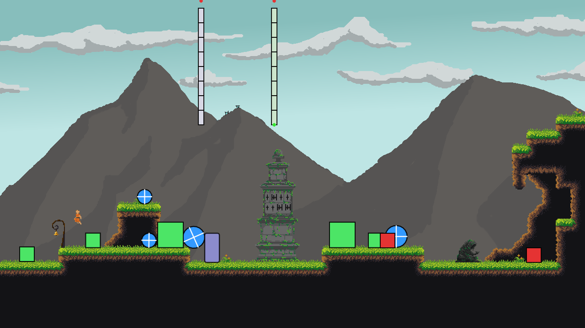
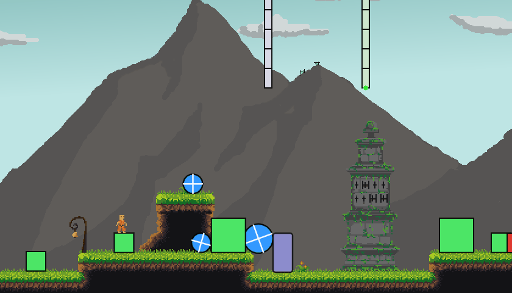
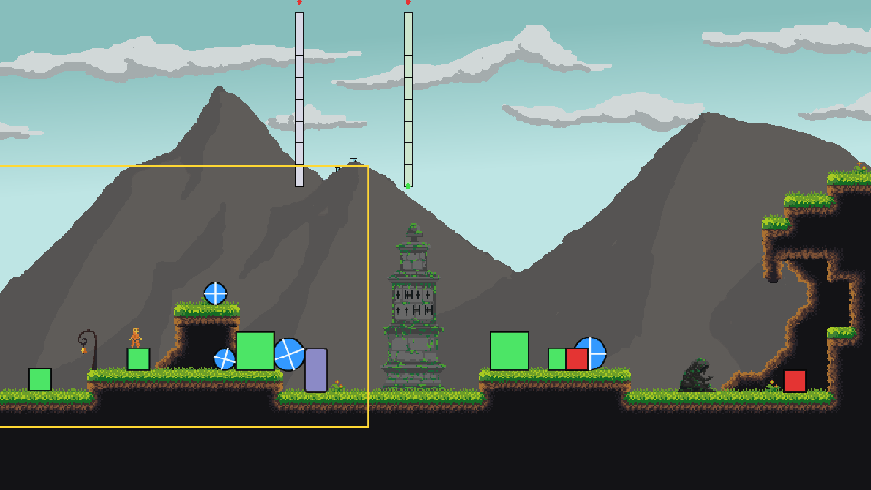
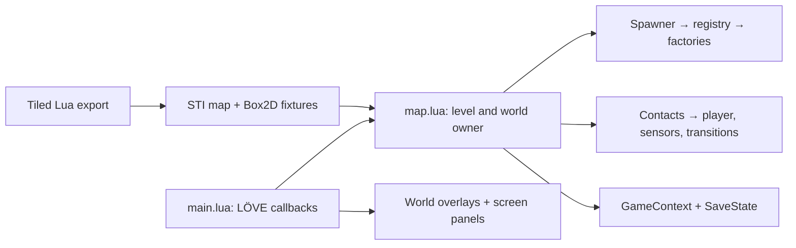

# 2D Platformer | Lua + LÖVE

A playable pixel-art platformer and a reference project for building your own 2D game in Lua. Explore Tiled levels, jump across platforms, and try physics props and interactions such as boxes, bells, buttons, and doors. Then turn on the in-game overlays to see the colliders, triggers, and transitions behind the scene.

[In action](#in-action) · [Run the game](#run-the-game) · [Architecture](#architecture) · [Build your own](#build-your-own)



## In Action

### Platforming



### Developer View

The same level with the debug tools enabled. Collider outlines and trigger regions appear over the scene; the player and transition inspectors show live runtime data.



[View the full-size debug screenshot](./mis/debug-overlays.png)

<details>
<summary>Original gameplay GIF</summary>


</details>

## Run the Game

1. Install [LÖVE 11.x](https://love2d.org/).
2. From the repository root, run:

```powershell
love .
```

The [STI map loader](./sti) is bundled. You only need [Tiled](https://www.mapeditor.org/) if you plan to edit levels.

## Controls

| Key | Action |
| --- | --- |
| A / D or ← / → | Move |
| W / ↑ / Space | Jump |
| E (or the configured key) | Interact with a nearby object or trigger |
| Mouse drag | Move a chain anchor |
| R | Reset player to (64, 64) |
| Esc | Quit |

<details>
<summary>Debug overlays (F1–F7)</summary>

| Key | Action |
| --- | --- |
| F1 | Camera guide controls |
| F2 | Box2D colliders |
| F3 | Trigger regions |
| F4 | Player state |
| F5 | Interactable hover inspector |
| F6 | Frame rate |
| F7 | Level transition inspector |

</details>

## Architecture

Level authors place tiles and objects in Tiled. The Lua export describes what goes into a level; the runtime decides how those objects behave. This lets you place or tune an existing entity without writing a new spawn path.



| Implemented system | How it works |
| --- | --- |
| **Level runtime** | [Map](./map.lua) owns the active STI map, Box2D world, and entities. Physics and authored colliders use the same pixel coordinates; visual scaling happens when drawing. |
| **Data-driven spawning** | The [spawner](./spawning/spawner.lua) reads the Tiled `entity` layer, resolves a type and variant in the [registry](./data/spawn_registry.lua), then calls a [factory](./spawning/factories). Object properties override the preset and defaults. |
| **Triggers and interactions** | [Sensors](./sensor_handler.lua) track entry and exit. [Interactable sensors](./interactable_sensor_handler.lua) also require a key press while the player is inside. |
| **Linked rooms** | The [transition handler](./level_transitions_handler.lua) links named Tiled regions across maps. `Map` switches levels and places the player at the destination. |
| **Runtime state** | [GameContext](./game_context.lua) exposes live Tiled objects. [SaveState](./save_state.lua) reapplies per-map entity properties without rewriting the level export. State is session-only by default; disk persistence is opt-in. |
| **Feedback and inspection** | [Audio](./audio.lua) uses a [sound registry](./audio/registry.lua). The [debug menu](./debugmenu.lua) exposes live player, physics, trigger, and transition data. |

## Build Your Own

Use this project as a reference for your own Lua and LÖVE game. Start with a Tiled level, place a registered object on the `entity` layer, and give it properties for that particular instance. Add a registry entry and factory when you need a new behavior. You can adopt individual systems, such as named triggers or the state overlay, by wiring them into your own map and contact lifecycle.

The [documentation](./docs) includes step-by-step guides, API examples, Tiled conventions, and troubleshooting notes:

| I want to… | Read |
| --- | --- |
| Author a map, place objects, or connect rooms | [Tiled level design guide](./docs/level_design_guide.md) |
| Add a box, door, or a new type of my own | [Adding entities](./docs/adding_entities.md) · [Spawning](./docs/spawning.md) · [Factories](./docs/factories.md) |
| React when a player enters a region or presses a key | [Sensors](./docs/sensors.md) · [Interactable sensors](./docs/interactable_sensors.md) |
| Keep changes when the player revisits a map | [SaveState](./docs/save_state.md) |
